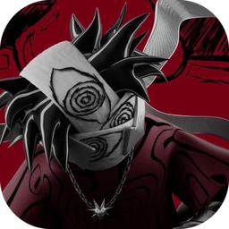
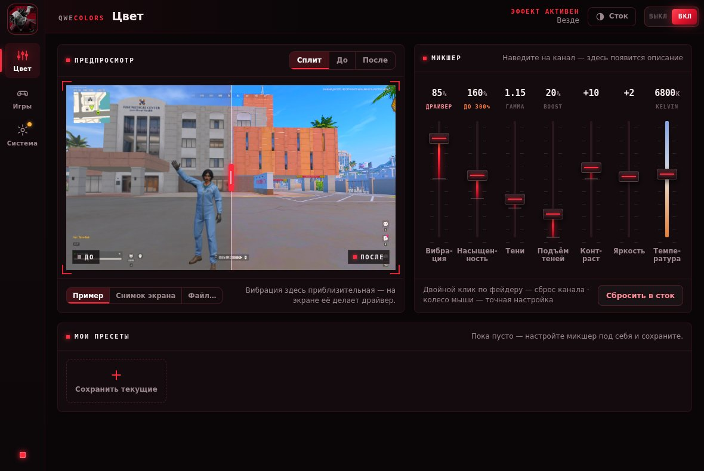

<p align="center">
  
</p>

<h1 align="center">QWECOLORS</h1>

<p align="center">
  Насыщенность до <b>300%</b>, цифровая вибрация, тени и цветовая температура — <b>по всему экрану Windows</b>.<br/>
  Копы, грабители и машины для побега буквально выпрыгивают с экрана — в Rob Run, любой другой игре и на рабочем столе.<br/>
  Эффект не слетает при Alt+Tab.
</p>



## Возможности

| | |
|---|---|
| **Вибрация (драйвер)** | Цифровая вибрация NVIDIA (NVAPI) или насыщенность AMD (ADL), как в панели управления видеокарты. Работает и в полноэкранных играх. |
| **Насыщенность до 300%** | Полноэкранная цветовая матрица Windows (Magnification API) — выходит за пределы того, что даёт драйвер. |
| **Тени (гамма), усиление теней, контраст, яркость, температура** | Гамма-рампа видеокарты (`SetDeviceGammaRamp`) на каждом мониторе. |
| **Свои пресеты** | Встроенных пресетов нет — настройте ползунки под себя и сохраните как пресет. Переключение в один клик, из трея или горячими клавишами. |
| **Микшер** | Семь вертикальных фейдеров: вибрация, насыщенность, тени, подъём теней, контраст, яркость, температура. Колесо мыши и стрелки — точная настройка, двойной клик — сброс канала. |
| **Предпросмотр «До / После»** | Режимы «Сплит», «До», «После» на примере, снимке вашего экрана или своей картинке. Та же математика, что и в движке. |
| **Только в выбранных играх** | Эффект включается, только когда активно окно нужной игры (по имени exe). |
| **Не слетает** | Watchdog каждые 2 с проверяет гамму и вибрацию и возвращает их, если игра или Alt+Tab их сбросили. Также после сна, блокировки и смены мониторов. |
| **Трей и горячие клавиши** | `Ctrl+Alt+Q` — вкл/выкл, `Ctrl+Alt+PgUp/PgDn` — переключение своих пресетов, кнопка «Сток» (пока зажата — экран без эффекта). |
| **Безопасно** | При выходе всё возвращается: исходная гамма, вибрация драйвера, матрица сбрасывается. |

## Установка

**Скачать:** [страница релизов](https://github.com/QWEES1DE/QWECOLORS/releases/latest).

Готовые сборки собирает GitHub Actions (`.github/workflows/build.yml`) на `windows-latest`:

- **QWECOLORS-Setup-x.y.z.exe** — установщик;
- **QWECOLORS-x.y.z-portable.exe** — портативная версия без установки.

Откройте вкладку **Actions** → последний запуск → артефакт `QWECOLORS-windows`.
Чтобы выпустить релиз, создайте тег: `git tag v1.0.0 && git push origin v1.0.0`.

Требования: Windows 10/11 x64. Для вибрации — видеокарта NVIDIA или AMD с актуальным драйвером.

## Разработка

```bash
npm install
npm start          # запустить приложение (Electron)
npm test           # тесты цветовой математики
npm run web        # веб-демо интерфейса: http://localhost:5173 (без доступа к экрану)
npm run dist       # собрать установщик и portable (на Windows)
```

Иконка генерируется из аватарки `assets-src/avatar.jpeg`: `python scripts/make-icons.py` (нужен Pillow).

### Структура

```
src/
  main/                 главный процесс Electron
    main.js             окно, трей, горячие клавиши, IPC, режим «только в играх»
    preload.js          безопасный мост к интерфейсу
    store.js            настройки (%APPDATA%/QWECOLORS/settings.json)
    engine/
      index.js          ColorEngine: собирает всё вместе + watchdog
      magnifier.js      MagSetFullscreenColorEffect — насыщенность
      gamma.js          SetDeviceGammaRamp — тени/контраст/яркость/температура
      nvidia.js         NVAPI Digital Vibrance
      amd.js            ADL Display Saturation
      win32.js          привязки WinAPI через koffi
  shared/
    colormath.js        общая цветовая математика (движок + предпросмотр)
    presets.js          пользовательские пресеты
  renderer/             интерфейс: боковая панель (Цвет / Игры / Система), микшер-фейдеры (fader.js), предпросмотр
```

### Как это работает

Конвейер повторяет то, что реально происходит в Windows:

1. **Цветовая матрица DWM** (Magnification API) — насыщенность: `out = Y + (in − Y) · s`, `s` до 3.0.
2. **Цифровая вибрация драйвера** — 50% = сток, 100% = максимум драйвера.
3. **Гамма-рампа видеокарты** — контраст → яркость → гамма теней → усиление теней → температура (Kelvin → RGB).

Если Windows отклоняет слишком «крутую» гамма-рампу, QWECOLORS автоматически переносит контраст, яркость и температуру в цветовую матрицу. Кнопка «Снять ограничение гаммы Windows» прописывает `GdiIcmGammaRange = 256` (нужны права администратора и перезагрузка).

### Ограничения

- Цветовая матрица Windows не действует в **эксклюзивном полноэкранном** режиме DirectX — для максимальной насыщенности ставьте в игре «Без рамки / Borderless». Вибрация и гамма работают в любом режиме.
- При включённом **HDR** Windows игнорирует гамма-рампу.
- Пока QWECOLORS включён, эффект действует и на его собственное окно — для честного сравнения зажмите «Сток».
- Magnification API несовместим с одновременно запущенной «Экранной лупой» Windows.
